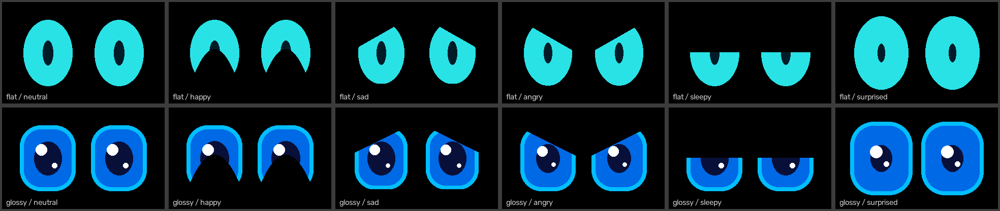

# ESP32 Robot Eyes

Animated cartoon robot eyes for an **ESP32-S3** and a **2.4" ST7789 color TFT** (240x320, SPI).
Clone, flash, and they come alive. Then build your own robot on top of the library.

[繁體中文說明](README.zh-TW.md)



*Frames captured straight from the ESP32's frame buffer: exactly what the screen shows.*

- Two styles: **Flat** (teal ovals with a small pupil) and **Glossy** (rim, iris, pupil, highlights)
- Six moods: neutral, happy, sad, angry, sleepy, surprised
- Smooth blinks (sometimes double), quick glances, random mood visits: it looks alive on its own
- ~38 fps on a 40 MHz SPI bus
- A small Arduino library (`RobotEyes`) to drive the eyes from your own code

## What you need

| Part | Notes |
|---|---|
| ESP32-S3 dev board | Any DevKitC-1 style board (N4, N8, N16R8 ...) |
| 2.4" TFT, ST7789, 240x320, SPI, 8 pins | Pins labeled `GND VCC SCL SDA RESET DC CS BL`; search "2.4 inch ST7789 240x320 SPI 8pin" |
| 8 female-female jumper wires | |
| USB cable | Data cable, not charge-only |

## 1. Wire it

| Screen | ESP32-S3 |
|---|---|
| GND | GND |
| VCC | 3V3 |
| SCL | GPIO 12 |
| SDA | GPIO 11 |
| RESET | GPIO 14 |
| DC | GPIO 9 |
| CS | GPIO 10 |
| BL | GPIO 13 |

`SCL` / `SDA` on these modules are SPI clock / data (not I2C). Use 3V3 for VCC.
Double-check **CS and RESET**: swapping them gives a solid white screen.

## 2. Flash it

You need Python 3 and [PlatformIO Core](https://docs.platformio.org/en/latest/core/installation/index.html)
(or the PlatformIO extension for VS Code).

```bash
pip install platformio
git clone https://github.com/ElroyChenWI/esp32-robot-eyes.git
cd esp32-robot-eyes
pio run -t upload
```

The first build downloads the ESP32 toolchain and takes a few minutes. PlatformIO finds the board's port
automatically; if you have several, add `--upload-port COM5` (Windows) or `--upload-port /dev/ttyUSB0`.
To watch the log: `pio device monitor`.

If the upload can't connect: hold **BOOT**, tap **RST**, release **BOOT**, and run the upload again.

**Prebuilt image:** every [release](../../releases) has `robot-eyes-esp32s3.bin`. Flash it without building:
`esptool.py --chip esp32s3 write_flash 0x0 robot-eyes-esp32s3.bin`.

## 3. Use it

| Action | Effect |
|---|---|
| BOOT, short press | Switch style (flat / glossy) |
| BOOT, hold 1 s | Invert colors (for screens that show a white background) |

Both settings are saved and survive power cycles.

Serial commands (115200 baud, one character each):

| Key | Action |
|---|---|
| `0`–`5` | Mood: neutral, happy, sad, angry, sleepy, surprised |
| `h` `l` `k` `j` `x` | Look left / right / up / down / ahead |
| `b` | Blink |
| `s` / `i` | Toggle style / color inversion |
| `p` / `r` | Pause / resume the autonomous behavior |
| `c` | Capture the current frame (see [tools/capture.py](tools/capture.py)) |

## Troubleshooting

| Symptom | Cause / fix |
|---|---|
| Solid white screen, backlight on | The screen gets no commands. Check SCL, SDA, CS, DC and RESET; **CS and RESET swapped** is a common one. |
| Completely dark | No power or backlight: check VCC, GND and BL. |
| White background, red / pink eyes | Your panel needs color inversion: hold BOOT for 1 second. |
| Garbled picture | Loose jumpers or very long wires. Re-seat them, or lower the SPI clock (see below). |
| Build fails with `opening output file ... No such file or directory` (Windows) | The project path contains an apostrophe, e.g. a user folder like `C:\Users\Joe's PC`. Clone to a plain path such as `C:\dev\esp32-robot-eyes`. |

## Build your own app

```
src/                    the RobotEyes library (drawing, moods, behaviors, display setup)
examples/AutoEyes/      the default firmware: button + saved settings + serial commands
examples/Basic/         the smallest possible sketch
tools/capture.py        save what the screen shows as PNGs (via the 'c' serial command)
tools/merge_bin.py      build step that writes the single flashable .bin
platformio.ini          builds examples/AutoEyes
```

Start by editing `examples/AutoEyes/AutoEyes.ino`, or point `src_dir` in `platformio.ini` at your own sketch.
The library in a nutshell:

```cpp
#include <RobotEyes.h>

RobotEyesDisplay display;  // default pins from the table above
RobotEyes eyes(display);

void setup() {
  eyes.begin();
  eyes.setAutoMood(false);         // keep the mood under your control
  eyes.setMood(EyeMood::Happy);
}

void loop() {
  eyes.update();                   // animate, draw, push one frame; call it every loop
}
```

| Call | What it does |
|---|---|
| `setMood(EyeMood::Neutral / Happy / Sad / Angry / Sleepy / Surprised)` | Change expression (eases in) |
| `setStyle(EyeStyle::Flat / Glossy)` | Change look |
| `lookAt(x, y)` | Gaze, -1..1 on each axis |
| `blink()` | Blink once |
| `setAutoBlink(bool)`, `setIdleMode(bool)`, `setAutoMood(bool)` | Autonomous blinks / glances / moods (all on by default) |
| `setFlatColors(eye, pupil)` | RGB565 colors of the flat style, e.g. `lgfx::color565(255, 180, 0)` |
| `setInvert(bool)` | Color inversion |
| `canvas()` | The last drawn frame (`LGFX_Sprite`, RGB565), e.g. to stream it somewhere |

Different wiring:

```cpp
RobotEyesPins pins;
pins.cs = 5;
pins.rst = 6;
pins.bl = -1;                              // BL tied to 3V3
RobotEyesDisplay display(pins, 20000000);  // optional: 20 MHz SPI for long wires
```

### Arduino IDE

Tested with the PlatformIO CLI only. The Arduino IDE should work the usual way, but it hasn't been tested:
install *esp32 by Espressif* (Boards Manager) and *LovyanGFX* (Library Manager), add this repo with
*Sketch → Include Library → Add .ZIP Library*, open *File → Examples → ESP32 Robot Eyes → AutoEyes*,
select *ESP32S3 Dev Module*, and upload.

## How it works

The eyes are drawn into a 320x200 off-screen canvas each frame and pushed to the screen in one go, so there is no
flicker. Each eye is a filled shape (an oval, or a rounded rectangle with an iris); expressions come from black
"lids" carved out column by column: a sloped top lid for sad and angry, an arc from below for happy, and both lids
meeting for a blink. Shapes ease toward each mood's target, and glances snap quickly like real eye movements.

## Credits

The look was inspired by [FluxGarage RoboEyes](https://github.com/FluxGarage/RoboEyes) (OLED). This project is
an independent implementation for color TFTs and shares no code with it. Drawing uses
[LovyanGFX](https://github.com/lovyan03/LovyanGFX).

## License

MIT, see [LICENSE](LICENSE).
